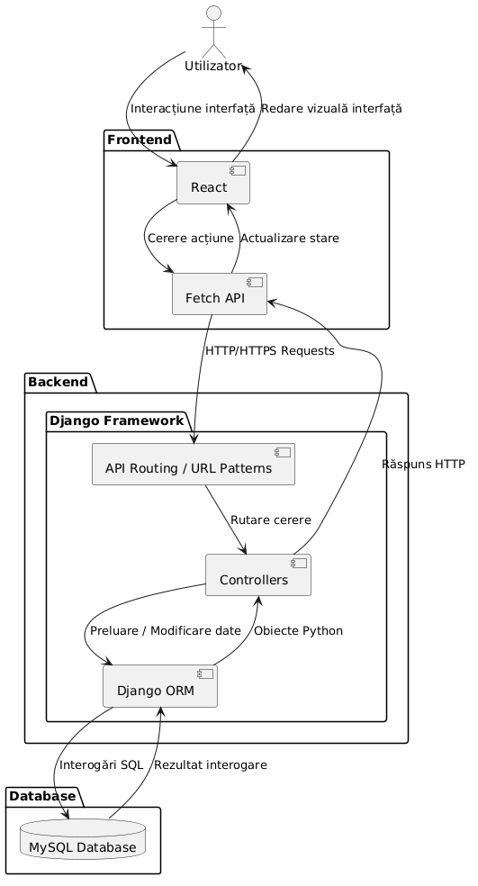

## 1. Frontend (React)

### `React` 
* **Descriere:** Este responsabil exclusiv de interfața cu utilizatorul (UI), gestionarea stării aplicației (ex. lista de obiceiuri, numărul de monede, streak-ul curent) și logica de prezentare.

### `Axios / Fetch API`
* **Descriere:** Clientul integrat în React care trimite cereri asincrone către serverul de backend fără a reîncărca pagina web.

### `Mecanism de autentificare`
* **Descriere:** Comunicarea este securizată folosind token-uri (JWT sau *Session/Cookie Authentication*), trimise în antetul (`Header`) al fiecărei cereri.

---

## 2. Backend (Django)

### `API Routing / URL Patterns`
* **Descriere:** Punctul de intrare pentru cererile primite de la frontend. Direcționează fiecare cale (ex. `/api/habits/`) către funcția sau clasa corespunzătoare.

### `Views / Controllers`
* **Descriere:** Prelucrează logica de business (ex. verificarea dacă un obicei a fost deja bifat azi, calcularea *streak-ului*, adăugarea de monede virtuale) și serializează datele în format **JSON**.

### `Django ORM` 
* **Descriere:** Abstracția care permite manipularea bazei de date folosind obiecte Python, fără a scrie interogări SQL manuale.

---

## 3. Database (MySQL)

### `MySQL Database`
* **Descriere:** Baza de date relațională în care se stochează structura definită în ERD (`User`, `Habit`, `Item`, `UserInventory`, `Friendship`). Asigură integritatea datelor și persistența pe termen lung.