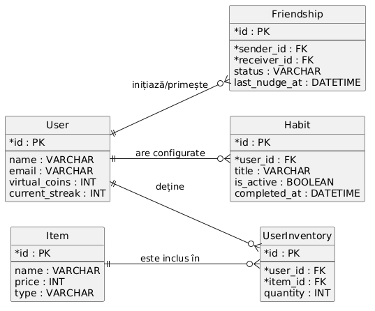

## 1. Utilizatori (`/api/users`) — Entitatea `User`

### `GET` `/api/users/me`
* **Descriere:** Prelucrează și returnează datele profilului utilizatorului autentificat (`name`, `email`, `virtual_coins`, `current_streak`).

### `POST` `/api/users/register`
* **Descriere:** Înregistrează un utilizator nou în sistem.

### `DELETE` `/api/users/me`
* **Descriere:** Șterge contul utilizatorului curent din aplicație.

---

## 2. Obiceiuri (`/api/habits`) — Entitatea `Habit`

### `GET` `/api/habits`
* **Descriere:** Returnează lista obiceiurilor utilizatorului (filtrare după `is_active = true`).

### `POST` `/api/habits`
* **Descriere:** Creează un obicei nou asociat utilizatorului (`user_id`, `title`, `is_active`).

### `POST` `/api/habits/:id/complete`
* **Descriere:** Marchează obiceiul ca fiind realizat (actualizează câmpul `completed_at` cu data/ora curentă, crește `virtual_coins` și `current_streak` ale utilizatorului).

### `DELETE` `/api/habits/:id`
* **Descriere:** Șterge un obicei din baza de date (sau îl marchează ca inactiv prin `is_active = false`).

---

## 3. Magazin și Inventar (`/api/items` & `/api/inventory`) — Entitățile `Item` & `UserInventory`

### `GET` `/api/items`
* **Descriere:** Returnează lista tuturor obiectelor disponibile în magazin (`name`, `price`, `type`).

### `GET` `/api/inventory`
* **Descriere:** Returnează articolele deținute de utilizatorul conectat și cantitatea acestora (`quantity`).

### `POST` `/api/inventory/buy/:itemId`
* **Descriere:** Cumpără un obiect: verifică dacă utilizatorul are destule `virtual_coins`, scade monedele și adaugă/incrementează obiectul în `UserInventory`.

### `POST` `/api/inventory/use/:itemId`
* **Descriere:** Folosește un obiect deținut (ex: consumă un *Streak Freeze* și scade `quantity`).

### `DELETE` `/api/inventory/:itemId`
* **Descriere:** Elimină complet un obiect din inventarul utilizatorului.